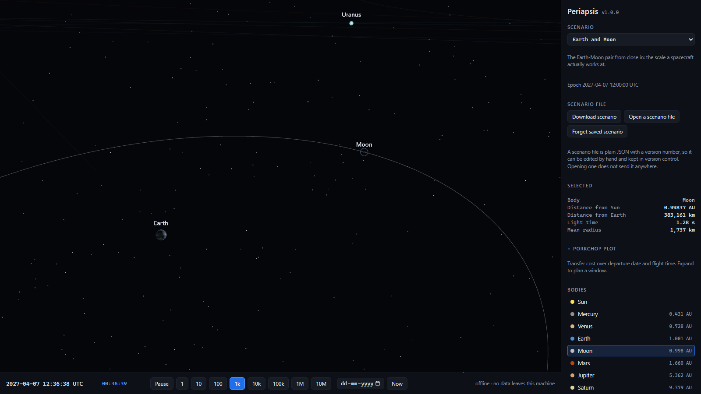
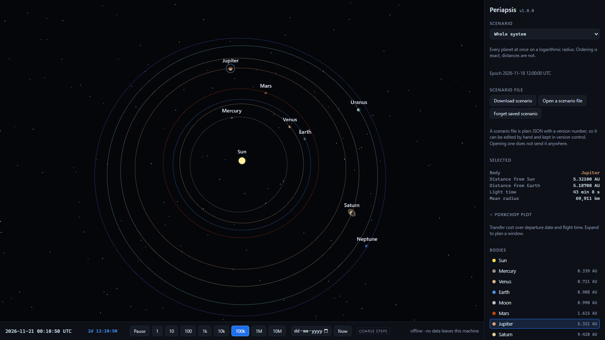
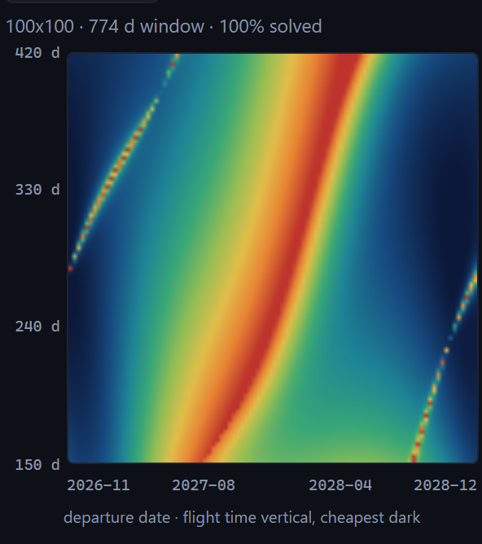

# Periapsis

An offline orbital mechanics sandbox and mission designer. Runs entirely in the browser: no
account, no server, no network at runtime.


**Status: v1.0.0, plus a true-scale renderer (unreleased).** The physics core is complete and
tested (691 unit tests, 62 end-to-end browser tests). The application shell runs with seven
scenarios, a warp clock from 1× to 10⁷×, a working mission layer, a porkchop plot that finds real
launch windows, and a ground track.

What that means in practice: a spacecraft flies a planned path drawn in the view, with maneuver
nodes and a delta-v budget. A porkchop cell can be turned into an actual departure burn out of a
parking orbit. A scenario can be saved in the browser, or written to a JSON file and opened again.
The node _editor_ (edit/delete) and the arrival half of an interplanetary transfer are not built
yet — see [Accuracy, honestly](#accuracy-honestly) for what that costs.

## Contents

- [Why it exists](#why-it-exists)
- [Screens](#screens)
- [One scale for everything](#one-scale-for-everything)
- [Using the view](#using-the-view)
- [Quick start](#quick-start)
- [The physics core](#the-physics-core)
- [Accuracy, honestly](#accuracy-honestly)
- [Design constraints](#design-constraints)
- [Documentation](#documentation)

## Why it exists

Two things, both of which are usually fudged by solar-system visualisations.

**The scale.** Most "solar system" views inflate the planets so you can see them, and then have
to push every moon and spacecraft out by the same factor so they clear the inflated planet. The
result is a picture where nothing is where it is. Periapsis draws every length at one true scale
and solves visibility on the _screen_ instead: a body too small to see from where the camera is
gets a minimum size in pixels, and grows to its real size as you zoom in. Two layouts are
available:

- **True scale** — real distances and real sizes. Zoom from the inner system down to a 550 km
  orbit hugging a true-size Earth without anything changing scale on the way.
- **Whole system** — a logarithmic radius map, so all eight planets fit on one screen. Ordering
  and directions are exact; distances are not, and the UI says so.

**The physics.** Positions come from JPL's elements, transfers from a Lambert solver, the lunar
free return from an N-body integration through the flyby. Every test tolerance has a stated
physical reason, and the limits of the model are listed in the UI and below.

## Screens

|                                                                                                                                           |                                                                                                                                                                                                               |
| ----------------------------------------------------------------------------------------------------------------------------------------- | ------------------------------------------------------------------------------------------------------------------------------------------------------------------------------------------------------------- |
|           |                                                                                               |
| **A mission in low Earth orbit.** A true-size Earth with procedural continents and cloud, and a 550 km orbit 1.086 radii from its centre. | **Earth and Moon.** True sizes, true separation, and the Moon's real orbit. The Moon is about a quarter of Earth's width and 60 Earth radii away — which is why the pair, not Earth alone, frames the camera. |
|        |                                                                                                                                |
| **A lunar free return.** One 3,115 m/s burn from a 300 km park, around the far side of the Moon, back to Earth — no second burn.          | **The whole system**, on the compressed logarithmic layout. The only way eight planets fit on one screen.                                                                                                     |

|                                                                                                                                                            |                                                                                                                              |
| ---------------------------------------------------------------------------------------------------------------------------------------------------------- | ---------------------------------------------------------------------------------------------------------------------------- |
|                      |                                  |
| **A porkchop plot.** 10,000 Lambert solves over departure date × flight time, for the Earth–Mars window. The dark band is the cheapest launch opportunity. | **A ground track.** The sub-satellite path projected onto a world map, with the antimeridian break drawn rather than hidden. |

## One scale for everything

Every length in the scene — planet positions, body radii, the Moon's offset, orbit paths,
spacecraft trajectories — is drawn at 100 scene units per AU. So, by construction:

| Quantity            | Drawn as  | Truth     |
| ------------------- | --------- | --------- |
| 400 km orbit radius | 1.063 R⊕  | 1.063 R⊕  |
| Moon radius         | 0.273 R⊕  | 0.273 R⊕  |
| Earth–Moon distance | 60.3 R⊕   | 60.3 R⊕   |
| Earth–Sun distance  | 23,481 R⊕ | 23,481 R⊕ |

Two screen-space rules keep that legible:

- **A minimum size in pixels.** Each frame, a body is drawn at its true radius or at a few pixels,
  whichever is larger. Up close it is exactly its real size; far away it is a marker. Nothing is
  ever drawn smaller than it is, and nothing is moved to make it visible.
- **Satellites appear when they separate.** From the inner-system camera the Moon is 0.8 px from
  Earth, so its marker would sit on Earth's. It is shown once there is a visible gap between the
  two discs: zoom towards Earth and the Moon appears, on its drawn orbit, exactly where it is.

Up to v1.0.0 the planets were drawn 282× too large and the Moon had to be pushed out by the same
factor — which put it three quarters of the way to the Sun. ADR-0008 records why that could not
be patched.

Each body also turns about its real spin axis (IAU pole directions): Earth's 23.4° tilt, Saturn's
rings 26.7° to its orbit, Uranus on its side, Venus and Uranus spinning backwards. Orbits are each
body's real inclined ellipse, so Mercury's 0.21 eccentricity is visible.

Surfaces are generated at runtime, deterministically, from 3D value noise on the unit sphere:

- Earth gets continents, ice caps and a separate translucent cloud shell
- the Moon gets maria and cratered highlands
- the gas giants get banded turbulence
- the Sun gets a granulated photosphere, plus a sprite glow and corona
- Saturn gets rings with a Cassini division

No image files are downloaded, nothing is fetched at runtime, and the same build produces the same
pixels. That is both a licensing decision and an offline one — see `docs/DECISIONS.md` D-044.

## Using the view

| Action                | How                                                  |
| --------------------- | ---------------------------------------------------- |
| Orbit the camera      | Drag                                                 |
| Zoom                  | Scroll, or `+` / `-`                                 |
| Select a body         | Click it, or click its row in **Bodies**             |
| Fly to a body         | Double-click it, click its row, or press `F`         |
| Pause / resume        | `Space`                                              |
| Change time warp      | `←` / `→`, or the buttons in the time bar            |
| Jump to a date        | The date field in the time bar; **Now** for today    |
| Hide orbits or labels | The **Orbits** and **Labels** toggles under **View** |

The camera follows the body it is framing, so a close-up stays put while the clock runs. The
selected body's panel shows its distance from the Sun and from Earth, the one-way light time,
and its radius.

## Quick start

Requires Node 24 (the pinned version in `docs/STATE.md`) and a modern browser with WebGL.

```bash
git clone <this-repository-url>
cd periapsis
npm ci
npm run dev        # http://localhost:5183
```

`npm ci` installs exact versions from the lockfile — every dependency is pinned without carets so
a clean clone is reproducible.

To check that the clone is healthy:

```bash
npm run verify     # typecheck + lint + 691 unit tests + production build
npm run test:e2e   # 62 Playwright tests driving the real app in headless Chromium
```

The e2e suite starts its own dev server. `npm run verify` and `npm run test:e2e` both pass on a
clean clone, and `docs/STATE.md` records the numbers from the last full run.

| Command                | What it does                                         |
| ---------------------- | ---------------------------------------------------- |
| `npm run dev`          | Vite dev server on http://localhost:5183             |
| `npm test`             | unit tests (691)                                     |
| `npm run test:e2e`     | Playwright end-to-end tests (62)                     |
| `npm run typecheck`    | `tsc` with strict settings                           |
| `npm run lint`         | ESLint, including the core-purity boundary           |
| `npm run build`        | typecheck + production build                         |
| `npm run verify`       | typecheck + lint + tests + build                     |
| `npm run bench`        | performance numbers for the pure work, in Node       |
| `npm run bench:frames` | frame rate and scenario-switch latency, in a browser |

## The physics core

`src/core` is a library with **zero runtime dependencies** that does not touch the DOM, the clock
or randomness. That is enforced by ESLint rules on `src/core/**` and `src/sim/**`, not by
convention, so the boundary cannot quietly erode (`docs/ADR/` ADR-0001).

- Vector algebra, time systems (JD, leap seconds, GMST, ERA)
- Classical orbital elements ↔ state vectors, elliptic and hyperbolic
- Kepler's equation, both cases
- Closed-form two-body propagation
- RK4 and Dormand–Prince RK45 integrators
- Solar system ephemerides (JPL approximate elements, Table 1)
- Restricted N-body acceleration with patched-conic sphere-of-influence selection
- Hohmann, bi-elliptic and plane-change transfers
- Lambert's problem, single revolution
- Porkchop grids: Lambert cost over departure date × time of flight, with transfer angle and plane
  tilt per cell
- Departure burns from a parking orbit: closed-form hyperbola solve, phase search, Oberth
  crossover, plane-change penalty
- Ground track: heliocentric → Earth-relative → equatorial (obliquity) → Earth-fixed (GMST), with
  geocentric latitude and an antimeridian break per segment
- Restricted N-body propagation to the Moon and back — the free-return trajectory is integrated
  through the lunar flyby rather than patched together from conics

`src/sim` sits on top: the warp clock, the simulation state, impulsive maneuvers in the local
orbital frame, and trajectory propagation with per-burn segments and delta-v accounting.

**Stack:** TypeScript 5.9.3, Vite 8.3.8, React 19.3.1, Three.js 0.187.0, Vitest 5.1.1,
Playwright 1.65.1. All pinned exactly.

## Accuracy, honestly

Ephemerides come from JPL's approximate Keplerian elements, not a full DE ephemeris. Mars' position
carries roughly 25,000 km of error, which makes Earth–Mars transfer delta-v indicative to a few tens
of m/s rather than operational. Gravity is Newtonian point-mass: no relativity, no J₂, no drag, no
solar radiation pressure. These are documented limits, not bugs, and they are stated in the UI
wherever a number depends on them.

The porkchop plot reports the sum of the two v-infinity speeds — the standard first-cut comparison,
and **not** the delta-v a mission spends, because it omits the Oberth effect of departing from and
capturing into a gravity well. Measured, that omission shifts the absolute number by a few percent
for Mars and Venus and by 26% for Mercury, while leaving the ranking of windows intact (Spearman
ρ ≥ 0.9997; `docs/PHYSICS.md` §11.2).

The departure half of that gap **is** closed in the app: a planned departure costs the real burn
from the parking orbit, so it is a different number from the cell's. On the default Earth–Mars
window the cheapest cell needs 3.03 km/s of departure v-infinity; the burn from a 300 km equatorial
park costs 6.58 km/s, of which 3.62 is the in-plane floor and the rest is the plane change the
geometry forces (`docs/PHYSICS.md` §12.4). Note the direction: at 3.03 km/s the excess speed is _below_
the Oberth crossover of 3.86 km/s, so the floor already exceeds the cell's number and the Oberth
effect is working against the mission, not for it.

The arrival half is **not** closed. Capture is still just the cell's arrival v-infinity, because a
craft in this model has one central body and patched conics are not in v1.0.0.

Other known limitations, all listed in `docs/STATE.md`:

- Node editing (edit/delete a burn) is not built; a node is planned and flown, not revised
- At whole-system zoom the inner planets are a few pixels apart, so lower-priority labels are
  hidden rather than overlapped; select a body to bring its label back
- Accessibility is verified by automation, not by a person using assistive technology

## Design constraints

- **Offline at runtime.** No network request is made by the app. No CDN fonts, no fetched textures,
  no telemetry. Storage is `localStorage` on the page's own origin; file output is a `Blob`
  download.
- **Deterministic rendering.** Surfaces are procedural and seeded by body, so the same build draws
  the same pixels. No `Math.random` in the render path.
- **A pure core.** No DOM, no clock, no randomness in `src/core` or `src/sim`, enforced by lint.
- **Justified tolerances.** Every test tolerance has a stated physical reason in `docs/PHYSICS.md`. A
  test is never loosened to get green — when one failed at 1.7e-7 against a 1e-7 bound, the
  discrepancy was reported rather than absorbed.

## Documentation

| File                                           | What it holds                                                   |
| ---------------------------------------------- | --------------------------------------------------------------- |
| [`docs/SETUP.md`](docs/SETUP.md)               | clean checkout to running app                                   |
| [`docs/ARCHITECTURE.md`](docs/ARCHITECTURE.md) | layers, boundaries, and why they are where they are             |
| [`docs/PHYSICS.md`](docs/PHYSICS.md)           | every model, and the justification for every test tolerance     |
| [`docs/STATE.md`](docs/STATE.md)               | verified current status, test inventory, known limitations      |
| [`docs/PERFORMANCE.md`](docs/PERFORMANCE.md)   | measured timings, frame rates and what was not measured         |
| [`docs/TESTING.md`](docs/TESTING.md)           | what is tested at which level, and the rules a test must follow |
| [`docs/GLOSSARY.md`](docs/GLOSSARY.md)         | orbital mechanics terms as this project uses them               |
| [`docs/DECISIONS.md`](docs/DECISIONS.md)       | smaller judgment calls made without asking                      |
| [`docs/PLAN.md`](docs/PLAN.md)                 | milestones and iteration backlog                                |
| [`docs/ADR/`](docs/ADR/)                       | the architectural decisions that shaped the codebase            |
| [`docs/CHANGELOG.md`](docs/CHANGELOG.md)       | what shipped in each release                                    |

Screenshots are regenerated with `node scripts/capture-readme.mjs` against a running dev server.

## Licence

MIT. See [LICENSE](LICENSE).
