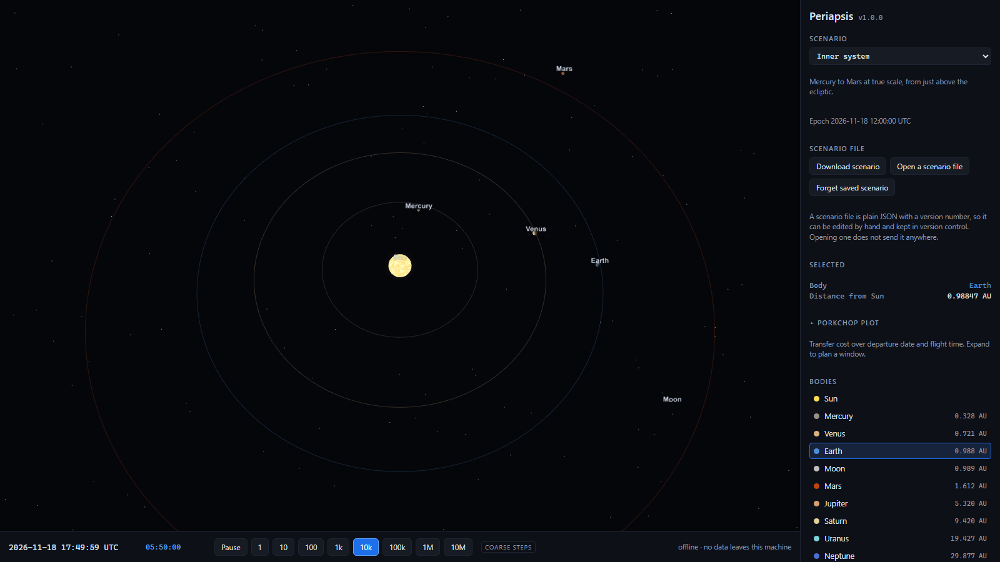

# Periapsis

An offline orbital mechanics sandbox and mission designer. Runs entirely in the browser: no
account, no server, no network at runtime.



**Status: v1.0.0.** The physics core is complete and tested (672 unit tests, 62 end-to-end
browser tests). The application shell runs with seven scenarios, a warp clock from 1× to 10⁷×, a
working mission layer, a porkchop plot that finds real launch windows, and a ground track.

What that means in practice: a spacecraft flies a planned path drawn in the view, with maneuver
nodes and a delta-v budget. A porkchop cell can be turned into an actual departure burn out of a
parking orbit. A scenario can be saved in the browser, or written to a JSON file and opened again.
The node _editor_ (edit/delete) and the arrival half of an interplanetary transfer are not built
yet — see [Accuracy, honestly](#accuracy-honestly) for what that costs.

## Contents

- [Why it exists](#why-it-exists)
- [Screens](#screens)
- [Bodies are drawn at a scale that tells the truth](#bodies-are-drawn-at-a-scale-that-tells-the-truth)
- [Quick start](#quick-start)
- [The physics core](#the-physics-core)
- [Accuracy, honestly](#accuracy-honestly)
- [Design constraints](#design-constraints)
- [Documentation](#documentation)

## Why it exists

Two things, both of which are usually fudged by solar-system visualisations.

**The scale.** Every "solar system" view you have seen lies about distance and size, because the
real numbers are unusable: the Sun is 109 Earths wide, and Neptune is 30 AU out. Periapsis does not
pretend otherwise, but it does show you *which* lie it is telling. Bodies carry an honest
size-to-distance mapping, and the mapping is switchable:

- **True scale** — real orbital radii, real body radii, cube-root compression of the radius only.
  The inner system is positional truth. This is the mode you use to see that Earth and the Moon
  really are that far apart.
- **Compressed** — a logarithmic radius map, so all eight planets fit on one screen. Ordering is
  exact; distances are not, and the UI says so.

**The satellites.** A satellite is drawn at its true size ratio to its parent, and carried by the
parent's display radius rather than by the parent's display *distance*. This sounds like a detail.
It is the difference between a Moon that orbits outside the Earth and a Moon that is drawn inside
it. At the linear distance scale, the Moon is 0.257 scene units from Earth while Earth's drawn
radius is 1.200 units: the Moon is literally buried in the planet unless the pair is positioned
relative to each other. `tests/placement.test.ts` pins that rule so it cannot regress.
## Screens

| | |
|---|---|
|  |  |
| **A mission in low Earth orbit.** Procedural continents and cloud, and a 550 km orbit drawn as a real arc rather than a hairline. | **Earth and Moon.** True size ratio, true separation. The Moon is about a quarter of Earth's width and 60 Earth radii away — which is why the pair, not Earth alone, frames the camera. |
|  |  |
| **A lunar free return.** One 3,115 m/s burn from a 300 km park, around the far side of the Moon, back to Earth — no second burn. | **The whole system**, on the compressed logarithmic layout. The only way eight planets fit on one screen. |

| | |
|---|---|
|  |  |
| **A porkchop plot.** 10,000 Lambert solves over departure date × flight time, for the Earth–Mars window. The dark band is the cheapest launch opportunity. | **A ground track.** The sub-satellite path projected onto a world map, with the antimeridian break drawn rather than hidden. |

## Bodies are drawn at a scale that tells the truth

The renderer uses two rules, and only two:

| Body kind | Display radius | Display position |
| --------- | -------------- | ---------------- |
| Planet (orbits the Sun) | Real radius, cube-root compressed | Real orbit radius, from the ephemeris |
| Satellite (orbits a planet) | Real radius ÷ real parent radius × parent's **display** radius | Parent's position + real offset ÷ parent's real radius × parent's **display** radius |

The cube root on planets is what lets Mercury and Jupiter share a screen: it maps a 29:1 radius
ratio to about 3.1:1, so the smallest planet stays visible without Jupiter swallowing it. The
satellite rule is what keeps topology honest: the Moon is 27% of Earth's radius, drawn 60 display
radii out, exactly as the transit geometry demands. There is no fudge factor.

One honest exception: a body has a floor of 0.35 display units so it stays clickable, and the Moon
lands on it. Its true ratio is 27.3%; as drawn it is 29.2%, about 7% too large. The floor is a
fixed size, so it matters less the more the parent is zoomed into — it never grows to swallow
Earth, which is what the old 1.6× "visibility" multiplier did.

Surfaces are generated at runtime, deterministically, from 3D value noise on the unit sphere:

- Earth gets continents, ice caps and a separate translucent cloud shell
- the Moon gets maria and cratered highlands
- the gas giants get banded turbulence
- the Sun gets a granulated photosphere, plus a sprite glow and corona
- Saturn gets rings

No image files are downloaded, nothing is fetched at runtime, and the same build produces the same
pixels. That is both a licensing decision and an offline one — see `DECISIONS.md` D-044.

## Quick start

Requires Node 24 (the pinned version in `STATE.md`) and a modern browser with WebGL.

```bash
git clone <this-repository-url>
cd periapsis
npm ci
npm run dev        # http://localhost:5183
```

`npm ci` installs exact versions from the lockfile — every dependency is pinned without carets so
a clean clone is reproducible.

To check that the clone is healthy:

```bash
npm run verify     # typecheck + lint + 672 unit tests + production build
npm run test:e2e   # 62 Playwright tests driving the real app in headless Chromium
```

The e2e suite starts its own dev server. `npm run verify` and `npm run test:e2e` both pass on a
clean clone, and `STATE.md` records the numbers from the last full run.

| Command | What it does |
| ------- | ------------ |
| `npm run dev` | Vite dev server on http://localhost:5183 |
| `npm test` | unit tests (672) |
| `npm run test:e2e` | Playwright end-to-end tests (62) |
| `npm run typecheck` | `tsc` with strict settings |
| `npm run lint` | ESLint, including the core-purity boundary |
| `npm run build` | typecheck + production build |
| `npm run verify` | typecheck + lint + tests + build |
| `npm run bench` | performance numbers for the pure work, in Node |
| `npm run bench:frames` | frame rate and scenario-switch latency, in a browser |

## The physics core

`src/core` is a library with **zero runtime dependencies** that does not touch the DOM, the clock
or randomness. That is enforced by ESLint rules on `src/core/**` and `src/sim/**`, not by
convention, so the boundary cannot quietly erode (`ADR/` ADR-0001).

- Vector algebra, time systems (JD, leap seconds, GMST, ERA)
- Classical orbital elements ↔ state vectors, elliptic and hyperbolic
- Kepler's equation, both cases
- Closed-form two-body propagation
- RK4 and Dormand–Prince RK45 integrators
- Solar system ephemerides (JPL approximate elements, Table 1)
- Restricted N-body acceleration with patched-conic sphere-of-influence selection
- Hohmann, bi-elliptic and plane-change transfers
- Lambert's problem, single revolution
- Porkchop grids: Lambert cost over departure date × time of flight, with transfer angle and plane
  tilt per cell
- Departure burns from a parking orbit: closed-form hyperbola solve, phase search, Oberth
  crossover, plane-change penalty
- Ground track: heliocentric → Earth-relative → equatorial (obliquity) → Earth-fixed (GMST), with
  geocentric latitude and an antimeridian break per segment
- Restricted N-body propagation to the Moon and back — the free-return trajectory is integrated
  through the lunar flyby rather than patched together from conics

`src/sim` sits on top: the warp clock, the simulation state, impulsive maneuvers in the local
orbital frame, and trajectory propagation with per-burn segments and delta-v accounting.

**Stack:** TypeScript 5.9.3, Vite 8.3.8, React 19.3.1, Three.js 0.187.0, Vitest 5.1.1,
Playwright 1.65.1. All pinned exactly.

## Accuracy, honestly

Ephemerides come from JPL's approximate Keplerian elements, not a full DE ephemeris. Mars' position
carries roughly 25,000 km of error, which makes Earth–Mars transfer delta-v indicative to a few tens
of m/s rather than operational. Gravity is Newtonian point-mass: no relativity, no J₂, no drag, no
solar radiation pressure. These are documented limits, not bugs, and they are stated in the UI
wherever a number depends on them.

The porkchop plot reports the sum of the two v-infinity speeds — the standard first-cut comparison,
and **not** the delta-v a mission spends, because it omits the Oberth effect of departing from and
capturing into a gravity well. Measured, that omission shifts the absolute number by a few percent
for Mars and Venus and by 26% for Mercury, while leaving the ranking of windows intact (Spearman
ρ ≥ 0.9997; `PHYSICS.md` §11.2).

The departure half of that gap **is** closed in the app: a planned departure costs the real burn
from the parking orbit, so it is a different number from the cell's. On the default Earth–Mars
window the cheapest cell needs 3.03 km/s of departure v-infinity; the burn from a 300 km equatorial
park costs 6.58 km/s, of which 3.62 is the in-plane floor and the rest is the plane change the
geometry forces (`PHYSICS.md` §12.4). Note the direction: at 3.03 km/s the excess speed is _below_
the Oberth crossover of 3.86 km/s, so the floor already exceeds the cell's number and the Oberth
effect is working against the mission, not for it.

The arrival half is **not** closed. Capture is still just the cell's arrival v-infinity, because a
craft in this model has one central body and patched conics are not in v1.0.0.

Other known limitations, all listed in `STATE.md`:

- Node editing (edit/delete a burn) is not built; a node is planned and flown, not revised
- Labels can collide at whole-system zoom, where Mercury through Mars are a few pixels apart
- Accessibility is verified by automation, not by a person using assistive technology

## Design constraints

- **Offline at runtime.** No network request is made by the app. No CDN fonts, no fetched textures,
  no telemetry. Storage is `localStorage` on the page's own origin; file output is a `Blob`
  download.
- **Deterministic rendering.** Surfaces are procedural and seeded by body, so the same build draws
  the same pixels. No `Math.random` in the render path.
- **A pure core.** No DOM, no clock, no randomness in `src/core` or `src/sim`, enforced by lint.
- **Justified tolerances.** Every test tolerance has a stated physical reason in `PHYSICS.md`. A
  test is never loosened to get green — when one failed at 1.7e-7 against a 1e-7 bound, the
  discrepancy was reported rather than absorbed.

## Documentation

| File | What it holds |
| ---- | ------------- |
| `SETUP.md` | clean checkout to running app |
| `ARCHITECTURE.md` | layers, boundaries, and why they are where they are |
| `PHYSICS.md` | every model, and the justification for every test tolerance |
| `STATE.md` | verified current status, test inventory, known limitations |
| `PERFORMANCE.md` | measured timings, frame rates and what was not measured |
| `TESTING.md` | what is tested at which level, and the rules a test must follow |
| `GLOSSARY.md` | orbital mechanics terms as this project uses them |
| `DECISIONS.md` | smaller judgment calls made without asking |
| `PLAN.md` | milestones and iteration backlog |
| `ADR/` | the architectural decisions that shaped the codebase |
| `CHANGELOG.md` | what shipped in each release |

Screenshots are regenerated with `node scripts/capture-readme.mjs` against a running dev server.

## Licence

Not yet chosen.
