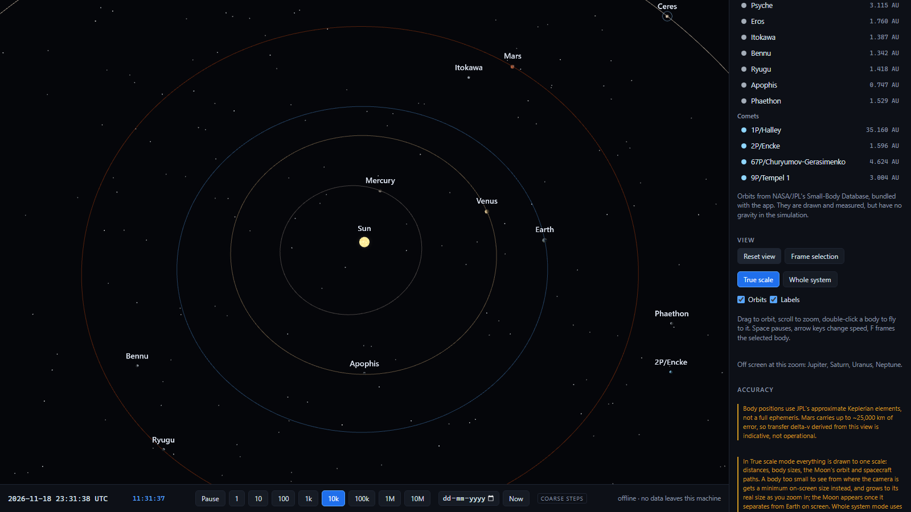
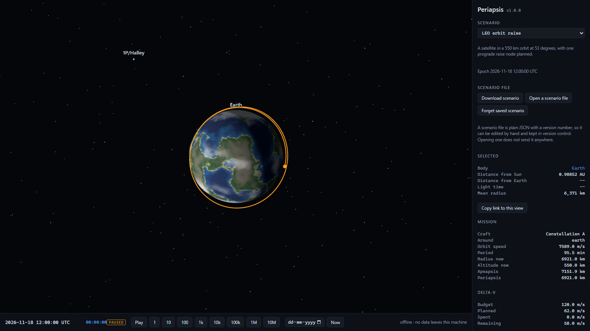
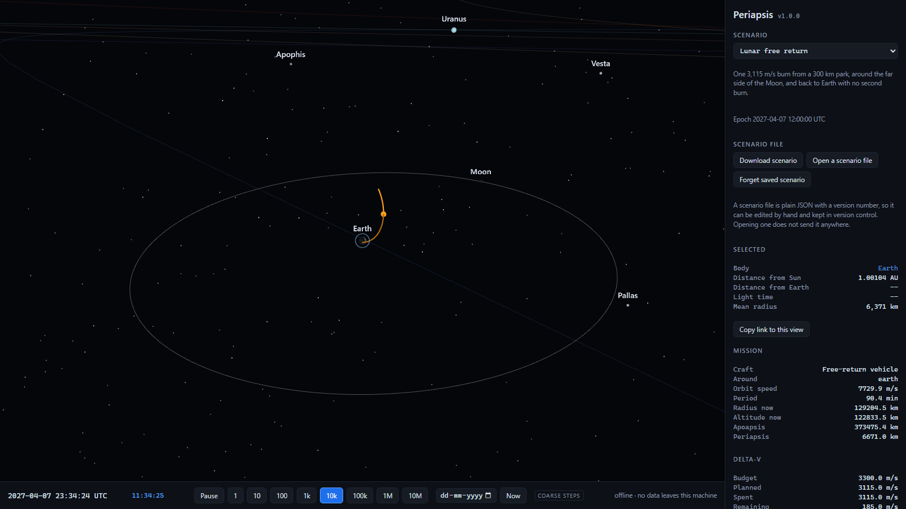
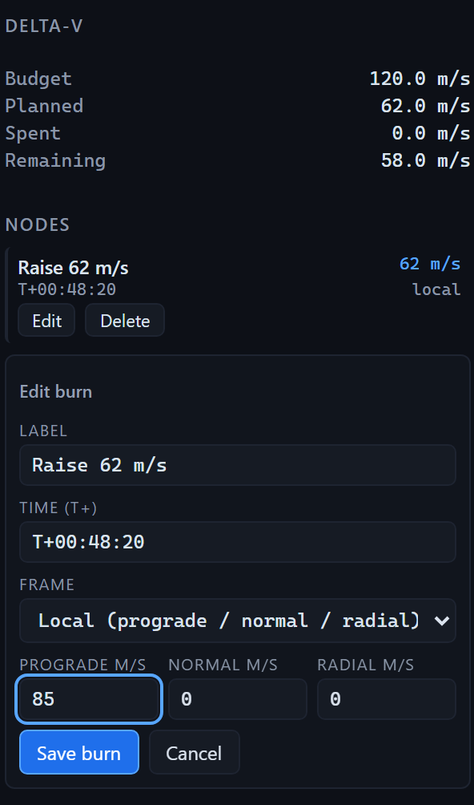
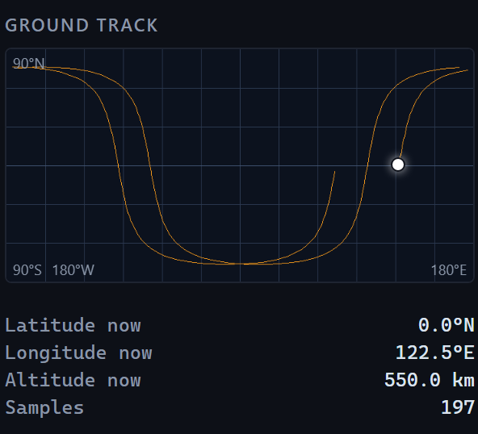

# Periapsis

**A true-scale solar system and mission designer that runs in your browser.** Fly from Neptune
down to a 550 km orbit around Earth without anything changing scale on the way; follow real
asteroids and comets; find launch windows with a porkchop plot and turn one into a burn.

**[Open the live app →](https://dsribalaji.github.io/periapsis/)** · no account, no install, and
nothing leaves your machine: it works offline once loaded.



## What you can do with it

- **Explore the solar system at true scale.** Every distance and size is real. Bodies too small to
  see from where you are get a minimum on-screen size and grow to their real size as you zoom in.
  Planets turn about their real axes: Earth's 23.4° tilt, Saturn's rings, Uranus on its side.
- **Find dwarf planets, asteroids and comets.** Ceres, Pluto, Eris, Vesta, Bennu, Apophis,
  Halley, 67P and more, with orbits from NASA/JPL's Small-Body Database. Jump to 13 April 2029
  and watch Apophis pass Earth.
- **Plan missions.** Put a spacecraft in orbit, add, edit and delete burns in its local frame, and
  watch the whole trajectory re-propagate as you type. A delta-v budget tells you when a plan
  cannot fly.
- **Find launch windows.** A porkchop plot solves 10,000 Lambert problems over departure date
  and flight time; click a cell to turn it into a real departure burn from your parking orbit.
- **See where a satellite is over the ground**, on a world map with the antimeridian handled.
- **Share exactly what you see.** "Copy link to this view" makes a link that reopens the same
  scenario, instant, target and camera.

Seven bundled scenarios cover the inner and outer system, the Earth–Moon pair, an orbit raise,
a GTO-to-GEO transfer, an Earth–Mars departure, and a lunar free return integrated through the
flyby.

## Screens

|                                                                                                                                     |                                                                                                                  |
| ----------------------------------------------------------------------------------------------------------------------------------- | ---------------------------------------------------------------------------------------------------------------- |
|                       |  |
| **Low Earth orbit.** A true-size Earth and a 550 km orbit 1.086 radii from its centre.                                              | **Earth and Moon.** True sizes, true separation, and the Moon's real orbit.                                      |
|  |              |
| **A lunar free return.** One 3,115 m/s burn from a 300 km park, around the far side of the Moon, home with no second burn.          | **The whole system** on a logarithmic layout: ordering and directions exact, distances not.                      |

|                                                                                 |                                                                          |                                                                              |
| ------------------------------------------------------------------------------- | ------------------------------------------------------------------------ | ---------------------------------------------------------------------------- |
|      |            |               |
| **Porkchop plot.** 10,000 Lambert solves; the dark band is the cheapest window. | **Burn editor.** Edit a node and the plan and budget update immediately. | **Ground track.** The sub-satellite path, with the antimeridian break drawn. |

## How it was built

TypeScript, React and Three.js, with a physics core written from scratch: Kepler's equation,
orbital elements, RK45 integration, restricted N-body, Lambert's problem, departure hyperbolas
and Earth-fixed ground tracks. **No physics library**, and the core has zero runtime
dependencies, enforced by lint.

The parts most worth reading:

- **[Engineering notes](docs/ENGINEERING.md)** — four bugs that passed the test suite (the Moon
  drawn beside the Sun, a 550 km orbit drawn as a 343,000 km streak, a precision loss a random
  seed found at apoapsis, and a 14.7 s startup) and what each one taught.
- **[Physics](docs/PHYSICS.md)** — every model, and a stated reason for every test tolerance.
- **[Architecture decisions](docs/ADR/)** — the choices that shaped the codebase, with the
  rejected options and their costs.

About 730 unit tests check the physics against independent facts (Apophis within 0.01 AU of
Earth on 13 April 2029, Halley at perihelion on 9 February 1986, a textbook Hohmann transfer),
and about 70 end-to-end tests drive the real app in Chromium, down to counting the pixels of a
trajectory on the canvas. CI runs all of it on every push.

## Accuracy, honestly

- Planet positions use JPL's approximate Keplerian elements, not a full DE ephemeris: Mars
  carries up to ~25,000 km of error, so transfer delta-v is indicative, not operational.
- Small bodies are propagated as pure two-body orbits from JPL's osculating elements. They are
  exact at each element epoch and drift away from it; the app shows each epoch and how far away
  it is.
- Gravity is Newtonian point-mass: no relativity, J₂, drag or radiation pressure. Small bodies
  have no gravity in the simulation.
- The porkchop plot reports total v-infinity, the standard first-cut comparison. A planned
  departure costs the real burn from the parking orbit; arrival and capture burns are not
  modelled yet.

These limits are stated in the app wherever a number depends on them.

## Run it locally

Requires Node 24 and a browser with WebGL.

```bash
git clone https://github.com/dsribalaji/periapsis.git
cd periapsis
npm ci
npm run dev        # http://localhost:5183
```

| Command                                  | What it does                                            |
| ---------------------------------------- | ------------------------------------------------------- |
| `npm run dev`                            | dev server on http://localhost:5183                     |
| `npm run verify`                         | typecheck + lint + unit tests + production build        |
| `npm run test:e2e`                       | end-to-end tests in headless Chromium                   |
| `npm run bench` / `npm run bench:frames` | timings for the pure work, and frame rates in a browser |
| `node scripts/fetch-small-bodies.mjs`    | refresh the small-body orbits from NASA/JPL             |
| `node scripts/capture-readme.mjs`        | regenerate these screenshots (needs the dev server)     |

## Controls

| Action                 | How                                                    |
| ---------------------- | ------------------------------------------------------ |
| Orbit / zoom           | Drag / scroll, or pinch on a touch screen              |
| Select / fly to a body | Click / double-click it, or use the lists in the panel |
| Pause, change speed    | `Space`, `←` / `→`                                     |
| Frame the selection    | `F`                                                    |
| Jump to a date         | The date field in the time bar; **Now** for today      |

## Documentation

| File                                           | What it holds                                         |
| ---------------------------------------------- | ----------------------------------------------------- |
| [`docs/ENGINEERING.md`](docs/ENGINEERING.md)   | the four bugs worth reading about                     |
| [`docs/ARCHITECTURE.md`](docs/ARCHITECTURE.md) | layers, boundaries, and why they are where they are   |
| [`docs/PHYSICS.md`](docs/PHYSICS.md)           | every model and the justification for every tolerance |
| [`docs/ADR/`](docs/ADR/)                       | architecture decision records                         |
| [`docs/DECISIONS.md`](docs/DECISIONS.md)       | smaller judgment calls                                |
| [`docs/TESTING.md`](docs/TESTING.md)           | what is tested at which level                         |
| [`docs/STATE.md`](docs/STATE.md)               | verified status and known limitations                 |
| [`docs/CHANGELOG.md`](docs/CHANGELOG.md)       | what changed in each release                          |

Small-body orbits: NASA/JPL Small-Body Database (public domain). Everything else, including the
planet surfaces, is generated by the app.

## Licence

MIT. See [LICENSE](LICENSE).
